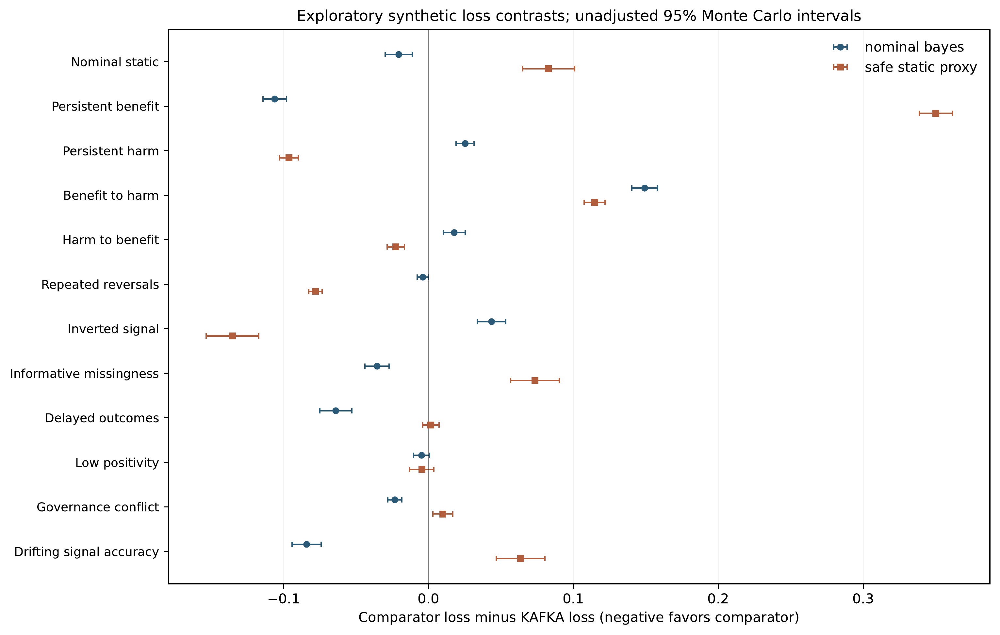
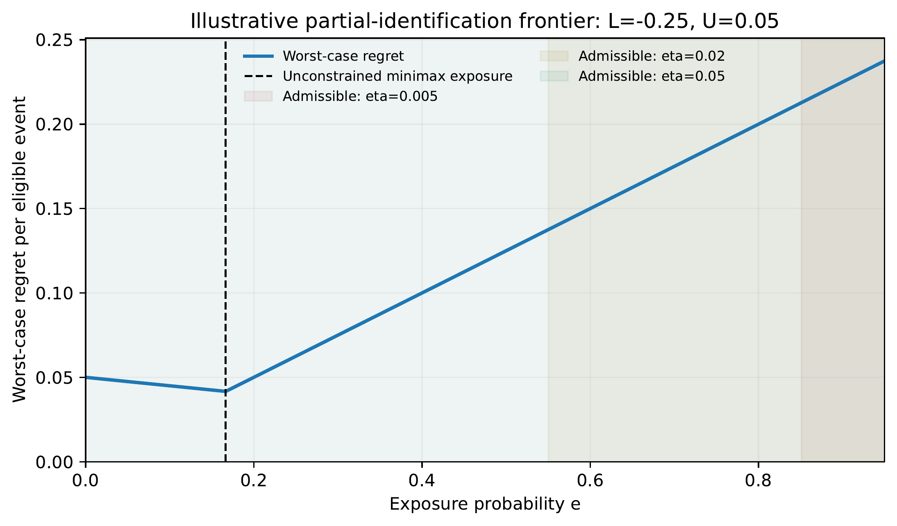

  <strong>KAFKA III</strong> 
  <em>When Should a Biomedical Prediction Lose Its Authority to Guide Care?</em> 
  Causal Identifiability, Safe Decision Frontiers, and Exploratory Falsification Tests

  
  
  
  

  <a href="#overview">Overview</a> ·
  <a href="#scientific-question">Scientific question</a> ·
  <a href="#evidence-and-results">Evidence</a> ·
  <a href="#reproducibility">Reproducibility</a> ·
  <a href="#repository-map">Repository map</a> ·
  <a href="#citation-and-license">Citation & license</a>

---

## Overview

**KAFKA III** is a methodological research program about the conditions under which a biomedical prediction or clinical decision-support recommendation should retain, lose, or regain authority to influence care.

Its starting point is that a prediction can remain statistically accurate while the act of displaying its recommendation changes clinician decisions, treatment, outcomes, and the observations subsequently used to evaluate the model. Post-deployment predictive performance is therefore not, by itself, an estimate of the causal effect of displaying a recommendation.

The project brings together causal estimands, partial identification, gain–loss analysis, temporal validity, constrained decision rules, and falsification-oriented simulation. Its purpose is not to certify a clinical model or to recommend a deployment policy. It is to make the assumptions and evidence requirements behind an authority decision explicit, testable, and auditable.

> **Research status.** This is an exploratory methods repository accompanying a preprint in development. The reported experiments are synthetic. The work has not established clinical efficacy, clinical safety, external validity, or incremental superiority over the broader safe-policy-learning literature. It has not been peer reviewed or externally validated.

## Scientific question

When should a biomedical prediction lose the authority to guide care?

The question concerns a decision system, not only a prediction model. A recommendation can affect the behavior of the clinician who receives it; the resulting treatment can affect the outcome; and the displayed recommendation can also affect whether and how that outcome is recorded. These pathways make three targets distinct:

1. **Predictive performance:** how well the model predicts a defined outcome under a specified observation and deployment regime.
2. **Intention-to-display effect:** the causal effect of making a frozen recommendation visible to an eligible decision-maker, including downstream clinician responses and treatment changes.
3. **Policy value:** the consequences of a policy governing display, restriction, withholding, review, or re-entry over time.

The primary causal framing in the manuscript is an intention-to-display estimand for a specified eligible population and care environment. It is not the isolated biological effect of a treatment, and it is not automatically the value of replacing an entire clinical workflow.

### The analytical framework

The manuscript organizes the problem around four connected questions.

- **Identification:** what can be learned about the effect of display from the available assignment, outcome, and missingness structure?
- **Decision under uncertainty:** how should exposure be chosen when the future effect is represented by an interval or other defensible uncertainty set, and when a reference policy must be protected?
- **Temporal validity:** under what assumptions can historical evidence constrain a future decision after the population, workflow, measurement process, or effect may have changed?
- **Governance:** what should happen when evidence is inconclusive, constraints conflict, or no regular action is admissible?

The paper restates elementary identification and minimax arguments as limits on what an authority rule can claim. These arguments are not presented as new general theorems. The static gain–loss construction is positioned relative to established work on partial identification and safe policy learning; a policy receiving the same information, action set, objective, constraints, and tie-breaking rule should not be relabelled as a novel method merely because it is implemented under a different name.

## Evidence and results

The repository contains several distinct research and audit stages. They use different models, estimands, horizons, and loss scales. Their numerical outputs must not be pooled into a single performance ranking.

### Static gain–loss analysis — v1.8A

The v1.8A experiment evaluates a single-decision, stratified setting across nine synthetic scenario families, with 400 replications per family and sensitivity analyses for transportability and a reference-policy loss constraint.

One exploratory result is favorable to the guarded map in a heterogeneous, informatively missing (MNAR) scenario:

| Synthetic family / policy | Regret per 1,000 eligible events |
|---|---:|
| Heterogeneity + MNAR — guarded map | **19.10** |
| Heterogeneity + MNAR — complete-case Bayes | 29.61 |
| Heterogeneity + MNAR — static minimax without baseline protection | 37.14 |
| Heterogeneity + MNAR — sentinel | 86.25 |

This result is conditional on the selected synthetic family and assumptions. It does not establish general superiority. In a mixed scenario with complete observations, the reported guarded-map regret was 11.07, while the complete-case Bayes rule achieved 4.70. In the recovery scenario, the guarded map had regret of 75.17, while the sentinel had 4.38. Those counterexamples are part of the result, not exceptions to be omitted.

The v1.8A report also documents that broad protection can sacrifice the ability to respond to genuine changes. Historical uncertainty and future validity are separate questions: an interval for a past effect does not automatically bound a future effect.

### Dynamic information-value experiment — v1.9D

The v1.9D package defines a six-period finite-state decision model with a static latent state, an exposure-dependent hypothetical observation channel, and an exact Bellman planner. It compares a myopic policy, a rollout policy, and an exact planner under matched information and authorization within the specified model.

The package evaluates 12 structural scenarios and 27 model-misspecification cells. In the assumed model, the exact planner is no worse than rollout or the myopic policy, as expected for that finite-horizon optimization problem. Under misspecification, however, the model-based advantage can reverse: in 15 of the 27 tested cells, the assumed-model optimum had greater true loss than the myopic rule.

The interpretation is deliberately narrow. This demonstrates a mechanism and a failure mode inside an illustrative synthetic model; it does not identify a clinical causal effect, establish that the assumed observation channel exists in practice, or demonstrate an advantage of the KAFKA III architecture over external methods.

### Dynamic stress study — v1.9E

The working manuscript reports a separate six-decision synthetic stress study with 18 scenario families and 129,600 policy trajectories. Its results are negative for a broad superiority claim: the simplified KAFKA authority gate had higher mean loss than nominal-model Bayesian planning in 13 of 18 families and higher mean loss than an exposure-zero static proxy in 7 of 18 families.

Examples include mean cumulative synthetic loss of 0.0963 for the KAFKA gate versus 0.0001 for the static proxy under persistent harm, and 0.3784 versus 0.2431 under an inverted signal.

**Important archive limitation:** the complete v1.9E source-and-results package is not currently present in this repository snapshot. The v1.9F audit archive contains a dependency snapshot of the v1.9E experiment script, but not the complete v1.9E result package and outputs. The manuscript's reported v1.9E figures should therefore not be treated as independently reproducible from the current GitHub tree alone.

### Baseline-equivalence audit — v1.9F

The v1.9F stage-one audit asks whether the static proxy used in v1.9E faithfully reproduces the guarded static rule from v1.8A. It does not.

An independent decision enumerator reproduced the original v1.8A guarded-rule choice in **129,600 of 129,600 evaluations**. Within those same v1.8A inputs, forcing exposure to zero would have changed the selected decision in 86.95% of evaluations and violated the v1.8A reference-loss constraint in 86.09%.

Those last two percentages are counterfactual diagnostics within the v1.8A decision environment. They are **not** observed violation rates for v1.9E. The audit establishes computational equivalence for the specific v1.8A rule and documents non-equivalence of the v1.9E proxy; it does not establish independent generation of the histories or equivalence to every external safe-policy-learning method.

The internal gates recorded in the audit are:
- v1.8A rule reconstruction: passed internally for the exact stated formulation.
- v1.9E proxy equivalence to the v1.8A rule: failed.
- Global confirmatory gate: blocked.

### Supplementary exploratory extension — v1.9G

The repository includes an English-language v1.9G manuscript addendum. It reports a later exploratory extension with 22 synthetic environments, eight policies, 800 paired episodes per environment, and six decisions per episode (140,800 policy trajectories).

The addendum reports that the KAFKA temporal gate had lower average simulated loss than the dynamic model-average Bayes comparator in 4 of 22 families and lower loss than a fixed-hazard Markov planner in 11 of 22 families. It did not have the lowest observed mean loss among all eight methods in any family.

This extension is explicitly post-result, exploratory, and synthetic. It does not establish incremental methodological superiority. The full v1.9G/v1.9H technical archive cited by the addendum is not included in the current repository snapshot; the addendum alone is not a complete reproduction package.

## Interpretation boundaries

The following boundaries apply throughout this repository.

- **No clinical efficacy claim.** No reported simulation establishes that a recommendation, model, or governance policy improves patient outcomes.
- **Synthetic evidence only.** The reported computational experiments use synthetic environments; no patient-level clinical dataset or human-participant experiment is claimed for these results.
- **No deployment authorization.** “Safe”, “guarded”, “sentinel”, “authority”, and “admissible” refer to definitions and constraints within specified analytical or synthetic settings. They are not clinical instructions, legal determinations, regulatory approvals, or validated safety guarantees.
- **No general superiority claim.** The project does not demonstrate that the KAFKA III architecture outperforms strong, information-matched dynamic Bayesian, robust, or safe-policy-learning comparators.
- **No automatic temporal transport.** Historical intervals, posterior beliefs, and simulation envelopes do not guarantee future validity without additional assumptions.
- **Negative results are retained.** Adverse scenarios, failed comparisons, and limits on novelty are part of the scientific record and must remain visible in future revisions.

A stronger claim would require, at minimum, a precisely identified display estimand; matched information, permissions, actions, costs, and uncertainty sets across comparators; strong multi-period baselines; externally justified clinical stakes and margins; a prospectively frozen evaluation design; independent assessment; and an explicit strategy for interference and delayed or selectively observed outcomes.

## Figures

### Figure 1 — Paired contrasts

### Figure 2 — Decision frontier

The imported figure assets have been moved into paper/figures/ and renamed to descriptive, stable filenames. The v1.9G addendum remains separately identified as exploratory supplementary material under paper/addenda/.

## Confirmatory protocol

The repository includes the author-recorded [confirmatory simulation protocol v1.1](protocols/confirmatory-simulation-protocol-v1.1.md). It fixes 12 scenario families, eight decision comparators, five new random seeds, margins of 2, 5, and 10 percentage points, and 576 planned contrasts for the two principal loss ratios (1:1 and 2:1). The 5:1 loss ratio is supplementary and is not part of those 576 contrasts. The protocol is a pre-execution specification, not a simulator or a report of confirmatory results. The definitive policy implementation and cited `manuscript_v0_3.md` remain unresolved inputs; no confirmatory result is claimed.

## Reproducibility

The ZIP archives preserve the supplied package contents. The commands below are reproduced from the package documentation and are intended to be run from the corresponding extracted package directory. They are not a claim that these commands were re-executed when this README was written.

### v0.5C — historical policy and loss archive

    python -m pip install numpy scipy
    python reproduce_all_v05c.py --full

The package README also describes a quick run without the --full flag as a two-replication check.

### v1.7 — L1–L3 limits audit

    python auditar_L1_L3.py
    python -m unittest test_limites.py -v

### v1.8A — static gain–loss map

    python -m unittest -q test_v18a.py
    python kafka_v18a_map.py --reps 400 --seed 18082026 --output outputs_recheck
    python kafka_v18a_map.py --reps 400 --seed 18182026 --output outputs_replication_recheck
    python posthoc_mapa_zonas.py

### v1.9D — finite-horizon information-value model

    python experiment_v1_9d.py > run_log.json
    python test_independent.py > independent_tests_log.txt

### v1.9F — static baseline-equivalence audit

    python audit_baseline_v1_9f.py

### v1.9E and v1.9G

No complete v1.9E result archive or v1.9G/v1.9H technical archive is currently included. A complete reproduction command is therefore not asserted for either stage.

For every run, preserve the original archive, record the Python and dependency versions, retain standard output and error, and compare regenerated files against the supplied checksums where available. Do not overwrite historical result files with a new run. Use a separate output directory and document any divergence.

## Current archive inventory

The repository is now organized into version and research-component directories. Original source bundles are preserved byte-for-byte in their corresponding version folders (or under archive/ where they are early/recovery material); only public repository filenames are normalized to English. Directory-level READMEs describe each component and its status. The original ZIPs remain preserved unchanged, and their members have also been extracted into version-specific `source/` directories as individual Git-tracked files. Extraction is an archival operation only: the workflow does not execute scientific code, rerun simulations, or validate scientific claims.

| Repository asset | Role in the research record |
|---|---|
| [Reproducible v0.2 package](archive/source_archives/kafka-iii-v0.2-reproducibility-package.zip) | Early reproducibility and probe-validation archive. |
| [v0.4 losses-and-delays package](v0.4/kafka-iii-v0.4-losses-and-delays-package.zip) | Original archive plus extracted source, report, configuration, and result files under `v0.4/source/`; scientific review remains separate. |
| [v0.5C policy-and-loss package](v0.5C/kafka-iii-v0.5c-policy-and-losses-package.zip) | Historical policy and loss archive; preserve as reference, without unplanned re-execution. |
| [v1.7 L1–L3 audit package](v1.7/kafka-iii-v1.7-l1-l3-limit-audit-package.zip) | Limit-audit report, source, tests, configuration, and result files. |
| [v1.8A static map package](v1.8A/kafka-iii-v1.8a-static-gain-loss-map-package.zip) | Static map, protocol, source, tests, outputs, replication outputs, and package manifest. |
| [v1.9D complete package](v1.9D/kafka-iii-v1.9d-finite-horizon-model-package.zip) | Exact finite-horizon model, independent tests, results, logs, and package manifest. |
| [v1.9F stage-one audit package](v1.9F/kafka-iii-v1.9f-stage-1-baseline-equivalence-audit.zip) | Independent static-rule enumerator, results, report, and dependency snapshots. |
| [v1.9F audit report](v1.9F/AUDITORIA_BASELINE_V1_9F.txt) | Plain-text copy of the v1.9F audit report. |
| [v1.9G English addendum](paper/addenda/MANUSCRIPT_ADDENDUM_V1_9G_EN.md) | Supplementary exploratory addendum; not a replacement for the main manuscript. |
| [Figure 1](paper/figures/figure1_paired_contrasts.png) · [Figure 2](paper/figures/figure2_frontier.png) | Figure assets imported from the manuscript workflow. |
| [Historical recovery bundle](archive/recovery/legacy-recovery-bundle-v0.2-v0.3.zip) | Archived v0.2/v0.3 recovery material retained for provenance only; it is not a KAFKA III methodological stage. |

A separate preflight check of the five newly supplied v0.5C, v1.7, v1.8A, v1.9D, and v1.9F ZIPs reported that all five archives passed ZIP integrity testing. The internal SHA-256 entries checked against their package manifests had no mismatches. The v1.9F package does not contain a recognized SHA-256 manifest. These checks establish archive integrity and the specified file-hash matches; they do not establish scientific validity or re-execution of the simulations.

## Repository map

### Current repository structure and remaining gaps

The current tracked tree is organized as follows; files marked pending are not yet deposited:

    KAFKAIII/
    ├── README.md
    ├── LICENSE (pending rights and license decision)
    ├── CITATION.cff (pending verified author metadata; Zenodo DOI not yet assigned)
    ├── MANIFEST_SHA256_REPO.txt
    ├── protocols/
    │   └── confirmatory-simulation-protocol-v1.1.md
    ├── provenance/
    │   └── package-name-map.md
    ├── paper/
    │   ├── README.md
    │   ├── figures/
    │   │   ├── figure1_paired_contrasts.png
    │   │   └── figure2_frontier.png
    │   └── addenda/
    │       └── MANUSCRIPT_ADDENDUM_V1_9G_EN.md
    ├── comparison/README.md
    ├── limits/README.md
    ├── v0.4/ (README + original ZIP + extracted source/)
    ├── v0.5C/ (README + original ZIP + extracted source/)
    ├── v1.7/ (README + original ZIP + extracted source/)
    ├── v1.8A/ (README + original ZIP + extracted source/)
    ├── v1.9D/ (README + original ZIP + extracted source/)
    ├── v1.9E/ (protocol + dependency snapshot; incomplete)
    ├── v1.9F/ (README + original ZIP + extracted audit source/)
    └── archive/ (early source archive + recovery material)

**Repository organization status.** The version folders and original source bundles are materialized in the GitHub tree. The archives for v0.4, v0.5C, v1.7, v1.8A, v1.9D, v1.9F, the early v0.2 reproducibility package, and the legacy recovery bundle have been extracted into their corresponding `source/` or archive-content directories. Original ZIPs remain intact alongside their extracted members. The workflow performs safe extraction and hash-manifest generation only; it does not run the simulations or scientific tests. The `paper/`, `comparison/`, and `limits/` directories contain indexes and available figures/addendum, while the final v0.3 manuscript and interval-comparison source remain outstanding.

### Outstanding repository work

Before treating the repository as a complete public preprint archive, the following items remain open:

1. Add the final v0.3 manuscript source, editable DOCX, and version notes under paper/. The available working manuscript supplied separately is labelled v0.1; it must not be silently relabelled as v0.3.
2. Populate comparison/ with the complete v0.2 interval-comparison source and outputs. Those materials are not in the currently inspected source set.
3. Review the extracted v0.4, v0.5C, v1.7, v1.8A, v1.9D, and v1.9F files against their package-level reports and manifests. The extraction manifests record byte hashes and source-member paths; they do not replace scientific or software review.
4. Recover and deposit the complete v1.9E source-and-results package. The dependency snapshot inside v1.9F is insufficient.
5. Deposit the complete v1.9G/v1.9H technical archive before claiming that the addendum is independently reproducible from this repository.
6. Recheck `MANIFEST_SHA256_REPO.txt` whenever tracked files change. It currently covers all tracked files except itself (146 entries at the time of this organization commit); preserve the original package-level manifests as well.
7. Add CITATION.cff after the author list, affiliations, and preferred citation metadata are verified. A Zenodo DOI is planned but has not been minted; no DOI should be cited until a public deposition returns one.
8. Select and add an explicit LICENSE. Public visibility alone does not grant permission to reuse code, text, or figures.
9. Resolve the policy and estimand inputs required by the v1.1 confirmatory protocol before implementing the confirmatory simulator; the protocol does not supply those missing scientific decisions.

## Citation and license

### Provisional citation

Author names, affiliations, and correspondence are still to be supplied and verified. The DOI has not been assigned.

    [Author(s) to be confirmed]. When Should a Biomedical Prediction Lose Its Authority to Guide Care? Causal Identifiability, Safe Decision Frontiers, and Exploratory Falsification Tests. KAFKA III preprint; working manuscript, 2026. DOI: not yet assigned.

Please cite a versioned release or commit rather than citing an unversioned working tree. Once a Zenodo record is created, replace this provisional entry with the complete citation and DOI and add a matching CITATION.cff.

### License status

No repository LICENSE file is currently present. The code, manuscript, and figures should not be assumed to share the same reuse terms. A possible release arrangement is Apache-2.0 for original code and CC BY 4.0 for original manuscript text and figures, subject to author approval and a check of third-party material. This is a proposal, not a license granted by this README.

## Research integrity and contribution policy

Changes to the scientific record should be traceable. Contributions that modify a model, estimand, action set, constraint, comparator, data-generating process, or analysis should include:

- a concise rationale and a description of the affected version;
- the exact source and configuration changes;
- tests and execution logs;
- machine-readable outputs and a checksum manifest;
- a clear distinction between pre-specified, exploratory, post-hoc, and confirmatory analyses;
- all adverse and null results, not only favorable scenarios.

Do not overwrite archived outputs. New analyses should receive a new version identifier or a clearly separated output directory. Changes to assumptions must be documented rather than silently merged into an earlier version.

The manuscript draft states that language and layout were assisted by generative AI. Scientific responsibility, source verification, authorship eligibility, conflict-of-interest declarations, and submission decisions remain with the human author(s). Funding and conflicts of interest must be completed and verified before public submission.

## Contact

The author list, institutional affiliations, and corresponding-author details have not yet been finalized in the supplied manuscript. Until those details are added, use the repository issue tracker for technical questions about the archived code and reproducibility record.

---

  KAFKA III · Exploratory methods research · Synthetic evidence only · Versioned and auditable scientific record

