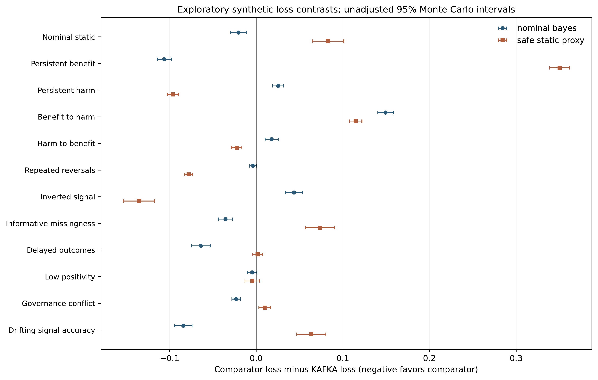
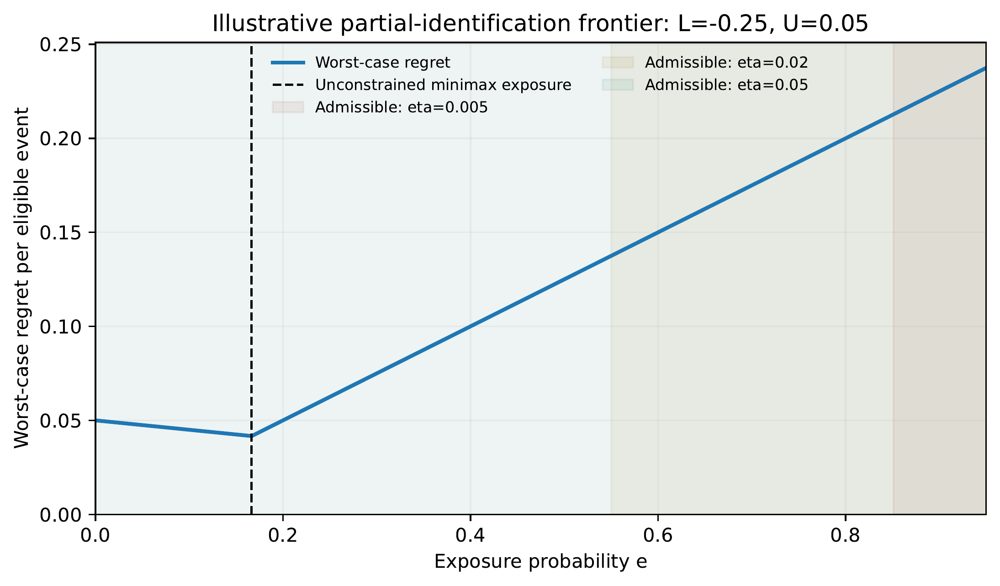

Abstract

**Background.** Prediction accuracy after deployment need not measure
the clinical effect of showing a prediction or recommendation, because
display can change decisions, treatment, outcomes, and subsequent
observations. We examine when a deployed recommendation can justifiably
retain, lose, or regain authority under incomplete causal information.  
**Methods.** We distinguish the intention-to-display effect from
treatment and prediction-performance estimands; restate three elementary
analytical limits concerning missing counterfactuals, risk-constrained
exposure, and unrestricted temporal change; and reanalyze two separately
designed synthetic experiment series. A static study (v1.8A) evaluated
nine scenario families, 400 replications per family, and sensitivity to
transportability and a reference-policy loss constraint. A distinct
six-period dynamic study (v1.9E) examined nine algorithms in 18
synthetic families (129,600 policy trajectories). An independent
implementation of the static decision rule was checked against 129,600
original rule evaluations (v1.9F software audit).  
**Results.** In the static heterogeneous, informative-missingness
family, a risk-constrained rule yielded regret of 19.10 per 1,000
eligible events versus 29.61 for a specified complete-case Bayesian
rule; however, this result did not establish novelty over equivalently
constrained safe policy learning and reversed in other scenarios. In the
dynamic study, a simplified authority gate had higher mean loss than
nominal-model Bayesian planning in 13/18 families and higher loss than
an exposure-zero static proxy in 7/18 families. Its loss was 0.0963
versus 0.0001 under persistent harm for the static proxy, and 0.3784
versus 0.2431 under inverted signals. The v1.9F audit reproduced all
static decisions but showed that the v1.9E static proxy was not the same
policy.  
**Interpretation.** The experiments support a negative and conditional
methodological conclusion: a defensible authority decision requires an
identified estimand, a temporally credible evidence set, a legitimate
action set, and comparisons with information- and permission-matched
policies. The synthetic experiments neither establish clinical efficacy
nor demonstrate an incremental advantage of the full KAFKA III
architecture.

**Keywords:** clinical decision support; causal identifiability;
algorithmovigilance; performative prediction; safe policy learning;
dynamic governance; partial identification; simulation audit.

Revision note. Version 0.3.11 records the public deposit of the v1.9E archive (commit a0a1948) and the verification of the v1.9E archive (SHA-256 fc220245…; manifest, 18 tests and byte-identical reproducibility check). Version 0.3.9 updates the bibliographic details of Montiel Olea, Qiu and Stoye (arXiv:2312.17623v3, the version checked), corrects the Waudby-Smith and Ramdas citation, and states that the v1.9E complete archive was not located in this review. Version 0.3.8 updated public archive locations and
provenance after filename normalization while retaining the scientific
corrections from v0.3.7. No experimental values, models, estimates, or
confirmatory decisions have changed. No confirmatory simulation has been
run; protocol v1.1 remains unchanged.

# Introduction

A clinical risk model may be accurate as a predictor and still be
harmful as part of a decision system. The model’s recommendation is
received by clinicians, who may change treatment in ways that
subsequently alter the outcome used to score the model. Consequently,
prediction performance, the effect of making a recommendation visible,
and the value of a hospital-level deployment policy are different
quantities. Prior work on performativity and clinical monitoring makes
this distinction consequential rather than semantic \[3, 4, 5, 7, 6\].

The practical question is not merely whether a score is calibrated, but
whether its current use should continue to influence care, be
restricted, be investigated, be suspended, or be considered for
re-entry. Such decisions trade off at least two clinically meaningful
errors: continued display of a harmful recommendation and withdrawal of
a beneficial one. They also influence the future evidence base:
suppressing display can remove the variation needed to identify the
effect of display. Ethical, operational, and regulatory authorization
must therefore be distinguished from statistical identification.

This question is not without precedent. Randomized evaluations have
explicitly varied whether recommendations or alerts are displayed. In
two such trials, the control arms generated recommendations that were
not shown to clinicians \[1, 2\]. One reported a significant change in
clinician resolution rates but no significant difference in
patient-level outcomes \[1\]; the other found no significant difference
in its primary or secondary outcomes \[2\]. Existing
safe-policy-learning work studies policy improvement under partial
identification and baseline safety constraints \[8, 9\]. Adaptive
experimentation already provides formal tools for sequential causal
inference \[10, 11\]; clinical AI governance discussions likewise use
monitoring, conditional release, and withholding as categories. We do
not claim these categories as new. An analysis of algorithmic authority
must avoid relabeling these established ideas as original inventions.

We therefore report a narrower contribution than an effectiveness claim.
First, we arrange identification, gain–loss frontiers, and temporal
transport into a common estimand-oriented decision contract; the
propositions are elementary analytical consequences, *not* claimed as
new theorems. Second, we subject two pre-existing KAFKA III exploratory
simulators to a transparent, falsification-oriented reading without
pooling incompatible outcome scales. Third, we audit a mismatch in a
comparator that would otherwise make a dynamic-governance superiority
claim misleading. This is a methods and negative-results preprint, not
an evaluation of a deployed clinical device.

# Causal target and units of authority

## Display is a treatment distinct from downstream care

Consider a frozen predictive model $S = f_{\theta}(X)$ and a threshold
$\tau_{0}$ defining eligibility $A = \mathbb{I}\{ S \geq \tau_{0}\}$
before a recommendation is displayed. Let $R$ be the recommendation,
$Z \in \{ 0,1\}$ the randomized or selected decision to display it, $D$
the subsequent clinician decision, $T$ the treatment received, and
$Y \in \{ 0,1\}$ a true favorable clinical outcome. Let $C_{obs}$ denote
a potentially corrupted or selectively recorded label, $O$ its
observation indicator, and $H_{t}$ the information accrued by decision
time $t$. Unobserved factors $U$ may affect clinical decisions and
outcomes; display may affect both the pathway
$Z \rightarrow D \rightarrow T \rightarrow Y$ and recording
$Z \rightarrow O,C_{obs}$.

For eligible encounters in a specified population and care environment
$P_{t}$, the primary causal target is

$$\Delta_{Z,t} = \mathbb{E}_{P_{t}}\{ Y_{t}(1) - Y_{t}(0) \mid A = 1\}.$$

A negative value denotes average harm from showing the frozen
recommendation. The intervention must keep the same underlying scoring
model, eligibility rule, and reference clinical workflow, changing only
whether its recommendation is visible. The intention-to-display effect
includes clinician response, nonadherence, and mediated treatment
effects; it is *not* the isolated biological effect of $T$, the
predictive risk in untreated persons, or automatically the total effect
of implementing an entirely new workflow \[3\].

When randomization of $Z$ is possible, identification of the
contemporaneous effect in Eq. (1) requires consistency and defined
treatment versions, randomization or conditional exchangeability,
positive allocation probabilities, valid outcome measurement, treatment
of selective missingness, and an appropriate no-interference assumption.
Known allocation probabilities help estimation; they do not remove
outcome measurement bias. If only $C_{obs}$ is available, even
randomized $Z$ does not alone identify the effect on the true $Y$.
Monitoring calibration or drift targets additional quantities, which can
be valuable without identifying $\Delta_{Z,t}$ \[4, 5, 6\].

## Exposure and regret

In a stylized no-interference stratum, let $e \in \lbrack 0,1\rbrack$ be
the fraction/probability of eligible encounters where a recommendation
is displayed, and let $\Delta$ be the corresponding effect on the
probability of a favorable outcome. The expected outcome relative to
universal non-display is
$\mathbb{E}\left\lbrack Y(0) \right\rbrack + e\Delta$. Compared with an
oracle choosing full display when $\Delta > 0$ and no display when
$\Delta < 0$, the per-encounter regret is

$$\ell(e,\Delta) = (1 - e)\max(\Delta,0) + e\max( - \Delta,0).$$

The two terms measure foregone benefit and exposure to harm without
double-counting. For a reference exposure $e_{0}$,

$$\ell(e,\Delta) - \ell\left( e_{0},\Delta \right) = \left( e_{0} - e \right)\Delta.$$

Operating costs can be added explicitly, but a biological loss already
contained in Eq. (2) must not be added again. Under shared resources or
interference, this individual-level expression is inadequate: the target
must be defined at a cluster or hospital policy level, such as $V(\pi)$,
with its own potential outcomes and design.

# Three limits that precede any authority rule

**Proposition 1** (Display without a counterfactual arm). *Suppose* $Y$
*is binary, display is constant at* $Z = 1$*, consistency holds, and no
other identifying restrictions are imposed. If*
$\mu_{1} = \mathbb{E}\lbrack Y \mid Z = 1\rbrack$*, then the sharp
identified set for the display effect is*
$$\Delta_{Z} \in \left\lbrack \mu_{1} - 1,\mu_{1} \right\rbrack.$$ *For*
$0 < \mu_{1} < 1$*, this interval contains strictly positive and
strictly negative effects.*

*Proof.* Consistency identifies
$\mathbb{E}\left\lbrack Y(1) \right\rbrack = \mu_{1}$, but imposes no
restriction beyond $\lbrack 0,1\rbrack$ on
$\mu_{0} = \mathbb{E}\left\lbrack Y(0) \right\rbrack$. Each
$\mu_{0} \in \lbrack 0,1\rbrack$ is attainable by a joint distribution
of binary potential outcomes with the observed $Y(1)$ marginal, giving
the stated sharp interval for $\mu_{1} - \mu_{0}$. At boundary means
$\mu_{1} \in \{ 0,1\}$, only one strict sign is possible; we do not
claim two-sided sign ambiguity there. ◻

This basic partial-identification argument is not novel. It explains why
post-deployment outcomes under deterministic display cannot, by
themselves, certify that showing the alert helps or harms. More data
from the *same* nonoverlapping regime narrow estimation error about
$\mu_{1}$ but do not reveal $\mu_{0}$. Partial identification,
cross-design data, structural assumptions, or exogenous display
variation may be needed \[8, 9\].

**Proposition 2** (Reference-constrained risk frontier). *Let the future
effect lie in a hypothesized interval* $\Theta = \lbrack L,U\rbrack$*,
where* $L < 0 < U$*, and restrict* $0 \leq e \leq e_{0} \leq 1$*.
Minimize the worst oracle regret in Eq. (2), subject to a tolerance*
$\eta \geq 0$ *on additional regret relative to* $e_{0}$ *in every world
of* $\Theta$*. Then* $$R(e;\Theta) = \max\{(1 - e)U, - eL\}$$

$$e_{\min} = \max\{0, e_{0} - \eta/U\}$$

esafe = Proj[emin, e0](U/(U − L)). *On a discrete authorized action set, choose a feasible
grid point minimizing* $R$ *with a predetermined tie rule.*

*Proof.* For $\Delta \geq 0$, regret is $(1 - e)\Delta$ and is largest
at $U$; for $\Delta \leq 0$, regret is $- e\Delta$ and is largest at
$L$. Their maximum is $R$. Equation (3) implies that the worst
incremental regret among $\Theta$ is $\left( e_{0} - e \right)U$, since
$e \leq e_{0}$, so the constraint is $e \geq e_{0} - \eta/U$. The two
affine terms in $R$ intersect at $U/(U - L)$; the minimizer over the
feasible interval is its projection. ◻

The construction is an illustrative, elementary instance of
baseline-constrained minimax regret, not a new generic policy-learning
algorithm. A historical interval
$\left\lbrack L_{h},U_{h} \right\rbrack$ should not be relabeled as
$\Theta$ without a transport condition. If the historical effect
$\Delta_{h}$ belongs to $\left\lbrack L_{h},U_{h} \right\rbrack$ and a
*separately justified two-sided* transport bound
$\left| \Delta_{t + 1} - \Delta_{h} \right| \leq b$ holds for the same
estimand, then $\left\lbrack L_{h} - b,U_{h} + b \right\rbrack$ is a
valid future envelope, conditional on both premises. By contrast, the
one-sided condition $\Delta_{t + 1} - \Delta_{h} \leq b$ bounds only the
upper endpoint and does not justify $L_{h} - b$. For example,
$\Delta_{h} = 0.05$, $b = 0.05$, and $\Delta_{t + 1} = - 0.25$ satisfy
the one-sided condition but not the proposed bilateral envelope. The
tolerance $\eta$ and authorized exposure set are normative and
context-specific, not quantities inferable from synthetic regret.

**Proposition 3** (Unrestricted future reversal). *Suppose two future
worlds are observationally indistinguishable at the decision point, one
with benefit magnitude* $d > 0$ *and the other with harm magnitude*
$d$*. Any action selected from the common history with mean exposure*
$e$ *incurs regrets* $d(1 - e)$ *and* $de$*, respectively.
Consequently,*
$$\inf_{e \in \lbrack 0,1\rbrack}\max\{ d(1 - e),de\} = d/2.$$

*Proof.* The maximum of the two nonnegative affine losses is at least
their average $d/2$, attained when $e = 1/2$. Restricting the action set
cannot lower this bound. Randomization conditional on the
indistinguishable history changes only the mean exposure and cannot
resolve the indistinguishability. ◻

This is a classical two-world minimax argument, not a theorem of KAFKA
III. Administrative review without a new informative observation cannot
distinguish these worlds. Temporal validity of evidence is therefore
logically separate from the formal permission to deploy.

## The cost of generating useful variation

Under an illustrative fixed-size, independently randomized
binary-outcome comparison with approximate common variance $\sigma^{2}$,
display-withholding allocation $q = \mathbb{P}(Z = 0)$, desired effect
$|\Delta|$, two-sided type-I error $\alpha$, and power $1 - \beta$, the
usual normal approximation is

N ≈ (z1−α/2 + z1−β)² σ² / (Δ² q(1−q)).

For $\sigma^{2} = 0.20$, $|\Delta| = 0.05$, $\alpha = 0.05$, and power
0.80, this gives approximately $N = 63,425$ at $q = 0.01$, $32,036$ at
$q = 0.02$, $13,219$ at $q = 0.05$, $6,977$ at $q = 0.10$, and $2,512$
at $q = 0.50$. These values illustrate the escalating information cost
of a rare arm. They are *not* a validated clinical trial sample-size
determination; the approximation excludes clustering, heterogeneous
effects, missingness, adaptive monitoring, and multiplicity. Randomized
display allocation must itself be ethically and institutionally
justified \[1, 2\]. Adaptive sampling with explicit costs has an
existing formal minimax treatment \[18\], which is an essential
benchmark for new information-acquisition claims.

# Exploratory study designs and provenance

## Static single-decision map (v1.8A)

The archived v1.8A experiment models four synthetic strata, each with 20
months and 125 historical encounters per month (2,500 per stratum).
Historical display occurs with probability 0.05. Nine scenario families
and 400 replications per family are crossed with sensitivity values
$b \in \{ 0,0.10,0.30\}$ for temporal transport and
$\eta \in \{ 0.005,0.02,0.05\}$ for protection against the loss of
withdrawing a beneficial alert. Each candidate receives the same
archived observed history in a replication; counterfactual future
effects are evaluation-only.

The reference exposure is $e_{0} = 0.95$. The synthetic feasible grid is
$\{ 0,0.05,0.25,0.50,0.75,0.95\}$ for constrained rules. A
risk-constrained KAFKA-map rule minimizes the worst regret in Eq. (2)
while bounding extra loss relative to the reference. Comparators include
the reference sentinel, always display/never display, historical and
temporally widened sign rules, a complete-case Beta-posterior heuristic,
and unconstrained static minimax. Informatively missing labels were not
imputed; their possible binary values were bounded. The Bayesian
heuristic does not correct this missingness, so it is intentionally
vulnerable rather than a maximally strong missing-data benchmark.

The performance measure is future oracle regret per 1,000 synthetic
eligible encounters, computed from the *expected value* of the specified
data-generating process rather than simulated future patient outcomes.
Scenarios include stable benefit/harm, mixed strata, no effect,
recovery, newly developing harm, and an informative-missingness mixed
scenario. Descriptive paired Monte Carlo intervals do not constitute new
causal confidence intervals. The originally emphasized favorable
configuration ($b = 0,\eta = 0.05$) was highlighted after exploratory
review, so inference about superiority would be selection-sensitive.

## Dynamic six-period stress test (v1.9E)

A separate simulator considers a six-decision trajectory and
$\theta_{t} \in \{ - 1,0, + 1\}$, with an action
$e_{t} \in \{ 0,0.25,0.5,0.75,1\}$ unless a specifically declared
continuous-grid rescue is used. Biological regret is
$0.10\left( 1 - e_{t} \right)$ for true benefit, $0.10e_{t}$ for true
harm, and zero for null effect. Synthetic acquisition costs
$0.001q_{true}\left( e_{t} \right)$ are added; a synthetic congestion
term $\kappa e_{t}^{2}$ appears in one proxy family, and a new review
incident costs 0.02. All regular policies face a budget of at most two
periods of partial-exposure probing. The assumed signal availability
function is

$$q(e) = q_{0} + 4\left( q_{\max} - q_{0} \right)e(1 - e),\quad\quad q_{0} = 0.02,\quad q_{\max} = 0.82.$$

The weak-positivity environment instead uses $q_{0} = 0.001$ and
$q_{\max} = 0.06$. The nominal environment has assumed signal accuracy
0.85, a prior probability 0.42 of benefit, and signals observed after
the decision. Delayed signals retain the originating cohort’s time
stamp; missing signals provide no belief update. Exposure changes
acquisition probability, so realized evidence can legitimately differ
among policies, even under shared potential random draws.

Nine decision policies were evaluated in each of 18 synthetic families
with 800 trajectories per family (129,600 policy trajectories; six
decisions per trajectory). The simplified KAFKA gate probes according to
a fixed schedule and requires a nominal posterior probability at least
0.80, evidence age at most two periods, and an exogenous simulated
re-entry permission. It is *not* the complete earlier KAFKA
architecture. Nominal Bayes uses finite-horizon dynamic programming
optimal only for its static assumed model, not for all tested
environments; the Bayes mixture uses two fixed accuracy hypotheses and
is not a general minimax POMDP. The other policies are a one-step
minimax heuristic, greedy, exposure-zero static proxy, historical
display, sentinel, and fixed probing.

The 18 families stress persistent benefit/harm, null effects, three
reversals, two-stratum heterogeneity, inverted/weak signals, prior
shift, informative missingness, additional delay, poor positivity,
cluster-congestion proxy, incompatible permissions, continuous-grid gap,
and drift in signal accuracy. The protocol was specified internally
before the first output, but the same developer tested and corrected
code after seeing preliminary runs. The final archive documents these
changes; this was not blinded, preregistered, or independently
evaluated. Contingency actions without a regular admissible action are
synthetic bookkeeping, not permissible clinical procedures.

## Static rule reconstruction and comparison audit (v1.9F, stage 1)

An independent scalar enumerator was written from the static
mathematical rule, receiving only $(L,U,\eta)$ and no true future
effect. It was compared with the original v1.8A rule for nine families,
400 replications, four strata, three $b$ values, and three $\eta$ values
(129,600 decisions). The original generator was reused, so independence
refers to the policy-selection implementation rather than the data
generator. This audit checked decision equivalence, not clinical
validity or equivalence to a particular published safe-policy-learning
algorithm. The archived v1.9E proxy chooses the smallest allowable
exposure rather than solving the risk-constrained static optimization;
the two methods also differ in evidence, reference exposure, action
grid, horizon, and loss units.

## Statistical reporting rules

The original v1.9E archive contains family-specific mean losses,
standard errors, paired differences, and unadjusted normal-approximation
95% Monte Carlo intervals based on common random numbers. We reproduce
the reported means and add a conservative post-hoc descriptive
normal-Monte-Carlo display using the Bonferroni critical value
$z_{1 - 0.05/(2 \times 18)} = 2.9913$ for each comparator’s 18-family
set. This correction addresses multiplicity only for those Monte Carlo
estimates under the normal approximation; it does not correct adaptive
choice of a model, establish an estimator’s causal coverage, or create
an externally validated experiment. Results from v1.8A and v1.9E have
different denominators, objectives, information, and action sets and are
*not pooled*. Reporting follows simulation-study guidance \[20\]. The
v1.9G supplementary addendum is not pooled with the present manuscript.

# Results

## One favorable static family is insufficient for a general claim

Table 1 displays preserved original static results in three deliberately
contrasting families. Under heterogeneous effects and informative
missingness, the guarded rule showed lower exploratory regret than the
specified, uncorrected Bayesian comparator. The same rule incurred
greater regret than that Bayesian comparator in the complete-observation
mixed family, and much greater regret than the near-always-display
sentinel under a recovery reversal. Its favorable result is conditional
on the particular simulation family, historically generated information,
$b = 0$, and a permissive $\eta = 0.05$; neither favorable stress-test
selection nor a weak comparator establishes an incremental method
contribution.

Static v1.8A exploratory oracle regret per 1,000 eligible synthetic
events ($b = 0$, $\eta = 0.05$ for guarded rule). Lower is better. The
methods use identical histories within a replication; this is *not* the
v1.9E loss scale.

| Family                       | Guarded map | Complete-case Bayes | Static minimax | Sentinel |
|------------------------------|-------------|---------------------|----------------|----------|
| Heterogeneity + MNAR         | **19.10**   | 29.61               | 37.14          | 86.25    |
| Mixed, complete observations | 11.07       | **4.70**            | 10.02          | 86.25    |
| Recovery (harm to benefit)   | 75.17       | 86.88               | 80.32          | **4.38** |

Static v1.8A exploratory oracle regret per 1,000 eligible synthetic
events (b=0, \eta=0.05 for guarded rule). Lower is better. The methods
use identical histories within a replication; this is not the v1.9E loss
scale.

The favorable MNAR comparison is especially limited by the model
specification: the Bayes heuristic ignores informative missingness
whereas the guarded method uses extreme missing-label bounds. A
competing safe policy rule supplied with precisely the same uncertainty
set, tolerance, objective, action grid, and tie rule would return the
same action by construction. The most plausible substantive research gap
therefore concerns *dynamic coupling* of information acquisition,
temporal uncertainty, and permissions—not the static frontier alone.

## Dynamic falsification: large adverse scenarios

Table 2 shows selected scenario families from the complete v1.9E
archive. The KAFKA gate had greater mean loss than the nominal-model
Bayesian planner in 13 of 18 families and greater loss than the static
exposure-zero proxy in seven; these are counts of synthetic families,
not probabilities of harm in clinical settings. The nominal planner also
fails in several misspecified environments: for example, it incurred
0.3346 in benefit-to-harm reversal versus 0.1855 for the gate. This
preserves the two-sided nature of the question without manufacturing a
universal winner.

Selected v1.9E mean cumulative losses over six synthetic decisions (800
trajectories/family; lower is better). Comparators are defined only
within this simulator.

| Family                     | KAFKA gate | Nominal Bayes | Zero-exposure proxy |
|----------------------------|------------|---------------|---------------------|
| Nominal static             | 0.1611     | **0.1406**    | 0.2439              |
| Persistent benefit         | 0.2500     | **0.1438**    | 0.6001              |
| Persistent harm            | 0.0963     | 0.1216        | **0.0001**          |
| Benefit $\rightarrow$ harm | **0.1855** | 0.3346        | 0.3001              |
| Harm $\rightarrow$ benefit | 0.3226     | 0.3404        | **0.3001**          |
| Repeated reversals         | 0.2781     | 0.2742        | **0.2001**          |
| Inverted signal            | 0.3784     | 0.4219        | **0.2431**          |
| Informative missingness    | 0.1756     | **0.1401**    | 0.2491              |
| Delayed outcomes           | 0.2573     | **0.1933**    | 0.2589              |
| Low positivity             | 0.2634     | 0.2586        | 0.2588              |
| Drifting signal accuracy   | 0.1953     | **0.1112**    | 0.2589              |

Selected v1.9E mean cumulative losses over six synthetic decisions (800
trajectories/family; lower is better). Comparators are defined only
within this simulator.

Under persistent harm, the paired difference *static proxy minus KAFKA*
was $- 0.0962$ (original unadjusted 95% Monte Carlo interval
$\lbrack - 0.1027, - 0.0897\rbrack$). With inverted signals the
difference was $- 0.1353$ (original interval
$\lbrack - 0.1534, - 0.1171\rbrack$). The nominal-Bayes-minus-KAFKA
difference under nominal static conditions was $- 0.0205$
($\lbrack - 0.0299, - 0.0112\rbrack$). For these same comparisons the
post-hoc Bonferroni descriptive intervals across the 18 corresponding
family contrasts were, respectively,
$\lbrack - 0.1061, - 0.0863\rbrack$,
$\lbrack - 0.1630, - 0.1075\rbrack$, and
$\lbrack - 0.0348, - 0.0063\rbrack$. The low-positivity proxy contrast
was $- 0.0046$ and its similarly corrected interval crossed zero,
$\lbrack - 0.0173,0.0081\rbrack$. Figure 1 plots original *unadjusted*
contrasts; the complete adjusted descriptive comparison file is
supplementary. No interval measures uncertainty about real patients or
the unknown effect of deployment.

Paired synthetic loss differences (comparator minus KAFKA) for 12
illustrative v1.9E families. Negative contrasts favor the comparator.
Error bars are original unadjusted normal 95% Monte Carlo intervals, not
causal confidence intervals. Families shown are a descriptive subset;
all 18 families appear in archived CSVs.

Additional operation checks in the final v1.9E code found no
regular-probe budget violation and no unauthorized gate re-entry under
its synthetic rules. In the low-positivity family the gate received only
0.1275 signals on average during six decisions, with 5.6025 inconclusive
periods per trajectory. The incompatible-governance family incurred
three contingency periods and one review incident by construction. These
are code-accounting checks, not evidence that such contingency exposures
are lawful or safe.

## The reference-policy mismatch is material

The independent reconstruction matched the archived guarded static rule
on all 129,600 evaluated decisions. In the original v1.8A inputs,
forcing $e = 0$ instead of its guarded decision would produce a
different action in 112,690 cases (86.95%) and would violate that
experiment’s risk constraint in 111,570 cases (86.09%). These are
*same-input diagnostic substitutions in v1.8A*; they are not
observations of policy violations in the v1.9E trajectories. Table 3
records the comparability diagnosis.

Internal software audit of static-rule equivalence; no efficacy
comparison.

| Diagnostic on v1.8A decisions                  | Count             | Fraction |
|------------------------------------------------|-------------------|----------|
| Independent enumerator equals archived guard   | 129,600 / 129,600 | 100.00%  |
| Forced exposure zero changes decision          | 112,690 / 129,600 | 86.95%   |
| Forced exposure zero violates v1.8A constraint | 111,570 / 129,600 | 86.09%   |

Internal software audit of static-rule equivalence; no efficacy
comparison.

The current v1.9E static proxy, however, uses an exposure-zero *target
projected onto its own regular feasible set*, not a literal forced zero
under v1.8A conditions. It is therefore improper to transfer the v1.9E
performance contrasts to claims against the original safe rule or a
published strong safe-policy-learning implementation. This newly audited
discrepancy is a blocker on a comparative efficacy claim rather than a
minor nomenclature issue.

# Discussion

## What the evidence supports

Three distinctions survive every negative test. First, *predictive
validity is not causal display efficacy*: appropriate monitoring of
performance is useful but does not solve missing counterfactuals for the
effect of showing a recommendation. Second, *identified history is not
identified future*: a tight historical confidence interval can be
irrelevant to a changed clinical process without a valid transport or
drift bound. Third, *administrative authority is not statistical
evidence*: permission, escalation, or audit can change feasible actions
and accountability, but it does not generate the unobserved
counterfactual effect. These are consequences of an estimand-first
analysis, not novel identifiability theorems.

The experiments reveal competing failures, not a general effect
direction. Under harm persistence, active acquisition and residual
exposure can be costly; under benefit persistence, reluctance to
re-enter can forgo gains; with inverted labels, the model can become
confidently wrong; under delay, evidence may be stale upon arrival. A
simplified gate sometimes mitigates reversals compared with a
misspecified Bayes planner, yet is worse than that planner in many other
families. The goal of a future controller would be a conditional,
well-defined improvement in prespecified settings—not dominance over all
conceivable worlds, which Proposition 3 precludes without additional
information.

## Relationship to prior work and originality boundary

*Identification and performativity.* Boeken et al. address causal domain
shift from decision support; Feng et al. examine monitoring choices and
error control in performative systems; Kim et al. study continuous
monitoring, and van Amsterdam et al. show the possibility of harm
despite apparently good discrimination \[3, 4, 5, 6, 7\]. Our scalar
model does not supersede these causal analyses.

*Safe learning and sequential inference.* Joshi et al. analyze safe
policies under partial identification, and Ben-Michael et al. analyze
safe improvement relative to deterministic references \[8, 9\]. The
static v1.8A guard is an instance of a known decision class. Cook et al.
and Waudby-Smith and Ramdas supply existing sequential confidence-sequence
machinery under conditions that must be checked; our simulations did
*not* implement or verify a general anytime-valid procedure \[10, 11\].
The modern nonasymptotic fixed-horizon literature also cannot be treated
as a free sequential guarantee \[12\].

*Closest prior work on coupling authority and observation.* D’Amour’s
commentary and its companion PNAS evaluation framework discuss selective
labels and the benefits of comparing randomized live decision arms \[13,
14\]. Our Proposition 1 applies the established one-arm
partial-identification logic and is not a novelty claim. Jiang et al.
investigate longitudinal causal inference with selective eligibility
after earlier interventions \[15\]; their target differs from authority
withdrawal and re-entry. Partial-identification treatment choice \[16,
17\] and costly sequential sampling \[18\] are especially important
comparators for the static frontier and information-acquisition claims.

Montiel Olea, Qiu and Stoye \[16\] (arXiv:2312.17623v3) demonstrate in a Gaussian
partial-identification decision framework that admissibility, maximin
welfare and optimal randomization can take counterintuitive forms. The
present deterministic reference-constrained scalar illustration does not
subsume that theory or establish an original minimax method.

*Governance.* Naming display, suspension, or re-entry states is not
claimed as original. The defensible increment of this manuscript is *the
explicit pairing of analytical limits with negative synthetic
benchmarking and a verifiable comparator audit*. Whether this synthesis
is sufficiently novel for a particular venue remains an editorial
question; we do not claim an original clinical control technology.

## A structural boundary on strict confirmatory superiority

Under Eq. (2), $\ell(e,0) = 0$ for every $e$. If $\Delta_{t} < 0$
throughout a family and the always-suspended policy ($e = 0$) has zero
operating cost, it attains zero total loss; if $\Delta_{t} > 0$
throughout and the always-active policy ($e = 1$) has zero operating
cost, it likewise attains zero total loss. Assuming other operating
costs are nonnegative, no candidate can achieve *strictly lower* total
loss against such an applicable zero-cost reference. This is a
conditional mathematical limitation, *not* an assertion that the full
confirmatory comparison is impossible before the complete cost and
permission model is specified. It must be assessed without consulting
confirmatory outcomes and without redefining the recorded success rule
after inspection.

The separate KAFKA III confirmatory simulation protocol v1.1, registered
internally on 12 November 2026, identifies twelve families, eight
comparators, five reserved confirmatory seeds, and 576 primary contrasts
across three noninferiority margins and two loss ratios. Its sensitivity
case with loss ratio 5:1 is additional and is not part of the 576
primary contrasts. The manuscript’s loss tolerance $\eta$ is *not*
equivalent, by definition, to the protocol’s noninferiority margin $h$
expressed in percentage points. Any operational mapping requires a
separately specified, author-approved mathematical contract. No
confirmatory simulator outputs are included in this manuscript; the
protocol itself is not evidence of superiority.

## What would be required to establish incremental dynamic value

A fair next evaluation must create a single causal simulator and a
single information contract. At each time, every controller should see
the same types of available histories, timestamped matured outcomes,
known propensities, missingness indicators, cost schedule, allowed
action set, and exogenous permission signals. Different *realized*
histories may arise because policies choose different exposure, but that
asymmetry must follow a common potential-data mechanism. A static safe
rule should have access to the same valid effect bounds when making a
comparable decision; a dynamic robust safe learner must not be omitted
merely because it may be strong. Bayes/POMDP planners must incorporate
delay and observation dependence appropriate to the same scenario rather
than only their convenient nominal specification.

A genuinely independent design would prospectively specify clinically
elicited loss weights and acceptable noninferiority margins, a primary
estimand, a small scientifically justified target family set plus
adverse falsifiers, an overall multiplicity plan, and blinded held-out
random seeds or generator code. The setting must represent
$Z \rightarrow D \rightarrow T \rightarrow Y$, valid observation of $Y$,
and, if interference is of interest, a hospital-level intervention and
enough independently randomized clusters. No clinical rollout follows
from synthetic gate invariants alone. Without those elements, repeating
the present toy experiments would not transform them into confirmation.
An interference scenario requires a cluster- or hospital-level value
estimand and a compatible randomization design, not merely the proxy
congestion term used in v1.9E \[19\].

## Limitations

The numerical results belong to artificial data-generating mechanisms.
The loss weights, probe budget, action grids, time horizon,
informative-missingness mechanism, prior, and synthetic permissions are
chosen for illustration, not justified by patient outcomes or a clinical
ethics committee. The v1.8A and v1.9E systems use different decision
horizons and loss scales; pooling them would be invalid. The guarded
static rule is mathematically equivalent to a safe learner with
precisely the same objective and constraints, but no claim of
equivalence to every published algorithm is made. The simplified v1.9E
gate is not a deployed KAFKA III system. Its cluster-congestion term
does not estimate effects under hospital interference. Test suites
verify implementation properties, not causal validity. The v1.9E
internal protocol was revised after internal observations, and v1.8A
results were explored before a favorable family was highlighted. Monte
Carlo intervals, even when descriptively multiplicity-adjusted, do not
repair model misspecification, analyst selection, or the absence of
blinded external assessment. No real patient data, prospective study, or
clinical validation are included. A comprehensive systematic literature
review and external review of formal novelty have not been completed.

# Conclusion

Authority to guide care is a decision about a causal intervention with
resource, temporal, and accountability consequences; it cannot be
derived from predictive accuracy or administrative review alone.
Elementary identification and regret arguments clarify why
always-displayed alerts can conceal harm, why safe suspension has a
cost, and why a past effect may fail to govern a changed future. The
KAFKA III exploratory evidence does not demonstrate superiority of
dynamic authority control: adversarial synthetic settings falsify broad
claims, and an audited benchmark mismatch blocks a narrower
strong-comparator claim. The present manuscript is therefore offered as
a reproducible, negative-results methodological account and a contract
for future independent tests, *not* as evidence supporting clinical
deployment.

# Statements and transparency

**Study type and ethics.** Mathematical analysis and fully synthetic
computation; no human participants or clinical datasets were used for
the reported experiments. No ethics approval for an actual randomized
alert study is claimed.

Registration. The exploratory experiments reported here were not
prospectively publicly registered or externally blinded. The author
recorded a separate confirmatory simulation protocol v1.1 on 12 November
2026, prior to confirmatory execution. SHA-256 of the registered repository file:
0fbf1c8d4849590c64567ff1636c03e654f924e3345c6d4b7b5ec0e71f6c36be. Public deposit (committed 13 November 2026, UTC):
https://github.com/miscrapha-DELTA-IA/KAFKAIII/blob/main/protocols/confirmatory-simulation-protocol-v1.1.md.
This does not establish independently verified prospective registration,
external validation, or confirmatory results.

Code and data. Public repository:
https://github.com/miscrapha-DELTA-IA/KAFKAIII. It contains the archived
v1.8A and v1.9F packages and the filename crosswalk. The complete v1.9E source-and-results archive is deposited in the public repository as “KAFKA_III_V1_9E_PACOTE_COMPLETO (1).zip” (commit a0a1948, 13 November 2026, UTC) and was verified as described in Appendix C. Complete public output deposition, independent audit and an
archival DOI remain pending. See Appendix C.

**Funding and conflicts of interest.** The earlier v0.3.6 title page
stated “none” for both fields, while its transparency section requested
author verification. Version 0.3.7 consistently marks both disclosures
as *awaiting explicit confirmation by the author*; absence is not
presumed. This editorial correction is not evidence of the presence of
funding or conflicts.

**Writing assistance.** Language and layout of this manuscript were
assisted by generative AI. Scientific responsibility, source
verification, authorship eligibility, conflicts, and final submission
decisions remain with the human author(s).

# Additional derivations and interpretation

## The decision frontier on an authorized grid

Figure 2 visualizes Proposition 2 for $L = - 0.25$, $U = 0.05$, and
reference $e_{0} = 0.95$. The unconstrained optimal exposure is
$U/(U - L) = 1/6$. With $\eta = 0.005$, the rule can choose only
$e \geq 0.85$ in the continuous interval; from
$G = \{ 0,0.05,0.25,0.50,0.75,0.95\}$ it selects $e = 0.95$. With
$\eta = 0.020$, admissible exposure begins at $0.55$ and the grid
solution is $e = 0.75$. With $\eta = 0.050$, the guard lower bound is
zero and the grid solution is $e = 0.05$, not the all-off action. These
choices reflect the chosen hypothetical envelope and tolerance, not
clinical recommendations.

An illustrative robust regret frontier for $L = - 0.25$, $U = 0.05$ and
$\eta \in \{ 0.005,0.02,0.05\}$. Feasible regions under three
tolerances. Only $e \leq e_{0}$ is considered. Envelopes are assumptions
about future effects, not confidence sequences.

## Why a conditional safety envelope is not a probability statement

If $\left\lbrack L_{h},U_{h} \right\rbrack$ is an interval for a
historical contrast with stated coverage, the future bound
$\left\lbrack L_{h} - b,U_{h} + b \right\rbrack$ requires, in addition,
a two-sided transport condition such as
$\left| \Delta_{t + 1} - \Delta_{h} \right| \leq b$ for the same effect
and population. A unilateral restriction on increases does not supply
the lower bound. Even if the historical interval covers the past with
probability $1 - \alpha$, violating the $b$ assumption can cause
complete failure for the future. Conversely, a normatively cautious
exposure under broad $\Theta$ may have high missed-benefit cost. A
governance “hold” or “re-review” instruction is therefore not itself a
statistical confidence assertion.

## Different estimands under intervention and interference

Randomized display can identify an intention-to-display effect if the
design and measurement conditions hold, but does not identify the
biological effect of a treatment when clinicians’ treatment decisions
are post-display mediators. Regression discontinuity at an alert
threshold identifies a local threshold intervention under continuity and
exclusion requirements, not automatically the same global $Z$ contrast.
Under shared beds and staff, the outcomes of patients may depend on
other patients’ alerts and treatment; a hospital-level policy value
$V_{h}(\pi)$ and cluster-level design are needed. The v1.9E proxy
$\kappa e^{2}$ does not supply that causal design \[19\].

# Full dynamic scenario inventory and select numerical diagnostics

p0.32rrr

Family & KAFKA gate & Nominal Bayes & Static proxy  
  
Family & KAFKA gate & Nominal Bayes & Static proxy  
Nominal model & 0.1611 & 0.1406 & 0.2439  
Persistent benefit & 0.2500 & 0.1438 & 0.6001  
Persistent harm & 0.0963 & 0.1216 & 0.0001  
Null effect & 0.0016 & 0.0014 & 0.0001  
Harm $\rightarrow$ benefit & 0.3226 & 0.3404 & 0.3001  
Benefit $\rightarrow$ harm & 0.1855 & 0.3346 & 0.3001  
Repeated reversals & 0.2781 & 0.2742 & 0.2001  
Two distinct strata & 0.1669 & 0.1278 & 0.3001  
Inverted signal & 0.3784 & 0.4219 & 0.2431  
Weak signal & 0.2730 & 0.2746 & 0.2694  
Prior shift & 0.2182 & 0.1391 & 0.5056  
Informative missingness & 0.1756 & 0.1401 & 0.2491  
Additional delay & 0.2573 & 0.1933 & 0.2589  
Low positivity & 0.2634 & 0.2586 & 0.2588  
Congestion (cluster proxy) & 0.2299 & 0.2278 & 0.2574  
Governance conflict & 0.2622 & 0.2390 & 0.2721  
Grid-only gap & 0.2099 & 0.1605 & 0.2469  
Drifting signal accuracy & 0.1953 & 0.1112 & 0.2589

The archive also includes eight other policies, the full component-cost
ledger, audit example paths and paired Monte Carlo differences.
Reporting a fixed set of selected scenarios in the main text does not
suppress the full outcomes in Table 4 or the supplementary CSVs.
Zero-looking values (e.g., 0.0001) are rounded and should not be
interpreted as exact zero.

# Reproducibility, archive boundaries, and audit checklist

1.  v1.8A source: v1.8A/kafka-iii-v1.8a-static-gain-loss-map-package.zip
    (original: PACOTE_KAFKA_III_V1_8A_MAPA_GANHOS_PERDAS_CINZENTO.zip).
    Unchanged SHA-256:
    5c4437d750c87a5562fc6ce32e25fcc47c0cf523bf0befd3338a1791f567cdbb.
    Source script kafka_v18a_map.py; prior software test: 10 tests.

2.  v1.9E source: KAFKA_III_V1_9E_PACOTE_COMPLETO.zip (separate
    supplementary bundle; not in public repository). SHA-256:
    fc220245bf4e0645446bc85a9475b22ad115d6afcc077b36d8e6b2685b192026.
    Main code experiment_v1_9e.py; test_v1_9e.py (18 prior tests).
    Verified on 13 November 2026 (repository file “KAFKA_III_V1_9E_PACOTE_COMPLETO (1).zip”): archive SHA-256 fc220245bf4e0645446bc85a9475b22ad115d6afcc077b36d8e6b2685b192026 matches this citation; its 18-file manifest checks (18/18 OK); its 18 unit tests pass; and its reproducibility check reproduces all five output files byte-identically. It is deposited in the public repository (commit a0a1948, 13 November 2026, UTC).

3.  v1.9F stage-one audit:
    v1.9F/kafka-iii-v1.9f-stage-1-baseline-equivalence-audit.zip. The
    independent scalar enumerator (audit_baseline_v1_9f.py), archived
    JSON outputs, and report assess equivalence on 129,600 original
    v1.8A decisions; they do not establish an independent data
    generator.

4.  **Reanalysis:** `verify_and_figures.py` reads archived CSVs and
    asserts the family counts, selected numbers, and scenario comparison
    signs. It writes and both figures. These are descriptive post-hoc
    operations; none of the original simulation outcomes is overwritten.

Public archive name mapping:
https://github.com/miscrapha-DELTA-IA/KAFKAIII/blob/main/provenance/package-name-map.md.
Eight archive paths were normalized to English lowercase filenames
without ZIP recompression; the original archive hashes remain in the
provenance map. The public rename does not constitute a new experiment
or validation.

5.  **External gate not met:** an internal confirmatory protocol v1.1
    now exists, but there is still no verified public preregistration,
    blinded external assessor, independently audited generator,
    real-data estimand validation, clinical utility elicitation,
    interference-identified study, or externally reviewed comparative
    benchmark. The internal registration must not be misrepresented as
    completed external validation.

# Research program gates before any stronger claim

| Gate                          | Condition before claim                                                                                                                         |
|-------------------------------|------------------------------------------------------------------------------------------------------------------------------------------------|
| Identification                | Define the contemporaneous $Z$ intervention, eligible population, mature true outcome, missingness model, and variation in display.            |
| Common-information comparison | Match history, timestamps, action and permission sets, budgets, costs, and uncertainty inputs across static/dynamic policies.                  |
| Strong comparators            | Implement equivalent safe policy learning and strong robust/delayed Bayesian multistage controllers, not a zero-exposure stand-in.             |
| Clinical relevance            | Elicit stakes, acceptable margins, autonomy costs, and contingency pathways with accountable clinical/ethics stakeholders.                     |
| Statistical validity          | Establish suitable fixed-horizon or truly time-uniform coverage for the claimed estimand, including multiplicity and adaptive data collection. |
| Independence and reproduction | Prospective external protocol, blind seeds/generators, audit of code and inference, and complete adverse-result reporting.                     |
| Interference                  | If hospital-level claims are made, specify cluster assignments, sufficient clusters, resource effects, and the hospital-policy estimand.       |

99 Moja L, Polo Friz H, Capobussi M, et al. Effectiveness of a
hospital-based computerized decision support system on clinician
recommendations and patient outcomes: a randomized clinical trial. *JAMA
Network Open*. 2019;2(12):e1917094.
<https://doi.org/10.1001/jamanetworkopen.2019.17094>. Downing NL,
Rolnick J, Poole SF, et al. Electronic health record-based clinical
decision support alert for severe sepsis: a randomised evaluation. *BMJ
Quality & Safety*. 2019;28:762–768.
<https://doi.org/10.1136/bmjqs-2018-008765>. Boeken P, Zoeter O, Mooij
JM. Evaluating and correcting performative effects of decision support
systems via causal domain shift. *Proceedings of Machine Learning
Research*. 2024;236:551–569.
<https://proceedings.mlr.press/v236/boeken24a.html>. Feng J, Subbaswamy
A, Gossmann A, et al. Designing monitoring strategies for deployed
machine learning algorithms: navigating performativity through a causal
lens. *PMLR*. 2024;236:587–608.
<https://proceedings.mlr.press/v236/feng24a.html>. Feng J, Gossmann A,
Pennello GA, et al. Monitoring machine learning-based risk prediction
algorithms in the presence of performativity. *PMLR*. 2024;238:919–927.
<https://proceedings.mlr.press/v238/feng24b.html>. Kim GYE, Corbin CK,
Grolleau F, Baiocchi M, Chen JH. Monitoring strategies for continuous
evaluation of deployed clinical prediction models. *J Biomed Inform*.
2025;168:104854. <https://doi.org/10.1016/j.jbi.2025.104854>. van
Amsterdam WAC, et al. When accurate prediction models yield harmful
self-fulfilling prophecies. *Patterns*. 2025;6(4):101229.
<https://doi.org/10.1016/j.patter.2025.101229>. Joshi S, Zhang J,
Bareinboim E. Towards safe policy learning under partial
identifiability: a causal approach. *Proc AAAI Conf Artificial
Intelligence*. 2024;38(12):13004–13012.
<https://doi.org/10.1609/aaai.v38i12.29198>. Ben-Michael E, Greiner DJ,
Imai K, Jiang Z. Safe policy learning through extrapolation: application
to pre-trial risk assessment. *J Am Stat Assoc*.
2025;120(551):1386–1399.
<https://doi.org/10.1080/01621459.2025.2489135>. Cook T, Mishler A,
Ramdas A. Semiparametric efficient inference in adaptive experiments.
*PMLR*. 2024;236:1033–1064.
<https://proceedings.mlr.press/v236/cook24a.html>. Waudby-Smith I,
Ramdas A. Estimating means of bounded random variables by betting. *J R
Stat Soc Series B*. 2024;86(1):1–27.
<https://doi.org/10.1093/jrsssb/qkad009>. Sandoval RJ, Balakrishnan S,
Feller A, Jordan MI, Waudby-Smith I. On nonasymptotic confidence
intervals for treatment effects in randomized experiments. *arXiv*.
2026;2601.11744. <https://arxiv.org/abs/2601.11744>. D’Amour A.
Advancing evaluation of AI systems when humans make the decisions.
*PNAS*. 2025;122(51):e2523997122.
<https://doi.org/10.1073/pnas.2523997122>. Ben-Michael E, et al. Does AI
help humans make better decisions? A statistical evaluation framework
for experimental and observational studies. *PNAS*.
2025;122(51):e2505106122. <https://doi.org/10.1073/pnas.2505106122>.
Jiang Z, Ben-Michael E, Greiner DJ, Halen R, Imai K. Longitudinal causal
inference with selective eligibility. *arXiv*. 2024;2410.17864 (v2,
2025). <https://doi.org/10.48550/arXiv.2410.17864>. Montiel Olea JL, Qiu C, Stoye J. Decision theory for treatment choice problems with partial identification. *arXiv preprint* arXiv:2312.17623v3, submitted 20 June 2025 (74 pages). <https://arxiv.org/abs/2312.17623>. The arXiv version 3 is the version checked. The journal version in the *Review of Economic Studies* (DOI 10.1093/restud/rdag015) was not checked; its theorem numbering and bibliographic details may differ. Manski CF. Choosing treatment
policies under ambiguity. *Annual Review of Economics*. 2011;3:25–49.
<https://doi.org/10.1146/annurev-economics-061109-080359>. Adusumilli K.
How to sample and when to stop sampling: the generalized Wald problem
and minimax policies. *Review of Economic Studies*. 2026;93(1):1–34.
<https://doi.org/10.1093/restud/rdaf021>. Hudgens MG, Halloran ME.
Toward causal inference with interference. *J Am Stat Assoc*.
2008;103(482):832–842. <https://doi.org/10.1198/016214508000000292>.
Morris TP, White IR, Crowther MJ. Using simulation studies to evaluate
statistical methods. *Statistics in Medicine*. 2019;38(11):2074–2102.
<https://doi.org/10.1002/sim.8086>.
